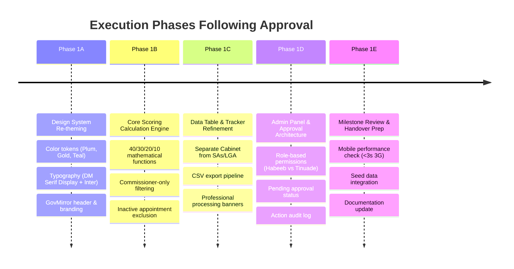

# GovMirror (VoteHerEkiti) — Client Clarifications, Status Review & Next Steps

**Date:** 22 October 2026  
**Document Version:** 1.0  
**Author:** Development Team  
**Project:** GovMirror (formerly VoteHerEkiti Gender Accountability Dashboard)  
**Target URL:** `govmirror.ng`  
**Client:** Women Too Africa Foundation (WTA)  
**Client Contacts:** Habeeb Adewale (Administrator & Sign-off Authority), Tinuade Mary (Editor)  

---

## 1. Executive Summary & Purpose

This document consolidates and formalises the written communications and clarifications exchanged between the development team and Women Too Africa Foundation (WTA) on **21–22 October 2026**. 

It serves three purposes:
1. **Document Resolved Specifications:** Translate the client's confirmed parameters (scoring logic, appointment categorisation, branding, and publishing workflows) into unambiguous development requirements.
2. **Review & Evaluate Pending Negotiations:** Provide an analysis of the submitted timeline extension request (proposing moving Phase 1 MVP delivery from 31 October 2026 to 20 November 2026).
3. **Establish an Actionable Next-Steps Roadmap:** Lay out the technical and operational roadmap that the project will execute once the build phase is re-authorized.

> [!IMPORTANT]
> **Active Directive:** No production code edits are to be executed until formal user go-ahead is provided. All preparation, architectural design, and formula modeling are documented herein for immediate execution upon clearance.

---

## 2. Summary of Resolved Client Specifications

The client has resolved the major ambiguities previously flagged in the project clarification document:

### 2.1 Accountability Index Scoring Engine (Formula Ratified)
The headline index operates on a 100-point scale across four defined pillars:

$$\text{Total Score} = S_{\text{Cabinet}} + S_{\text{Policy}} + S_{\text{Charter}} + S_{\text{Inclusive}}$$

| Dimension | Weight | Mathematical Formula | Rules & Edge Cases |
| :--- | :---: | :--- | :--- |
| **Cabinet Gender Ratio** | **40 pts** | $\min\left(\left(\frac{\% \text{ Women in Active Cabinet}}{35\%}\right) \times 40, \; 40\right)$ | **Scope Restriction:** Only State Executive Council (Commissioners) count toward the active cabinet count. Special Advisers, Board members, and LGA appointees are excluded from this calculation. |
| **Policy Commitment Fulfilment** | **30 pts** | $\left(\frac{\text{Pledges Fulfilled or In Progress}}{\text{Total Signed Pledges}}\right) \times 30$ | Partial scores are awarded proportionally. Both "Fulfilled" and "In Progress" count toward positive progress in the numerator. |
| **Charter Demand Response** | **20 pts** | $\left(\frac{\text{Demands Acknowledged or Acted On}}{\text{Total Demands}}\right) \times 20$ | Both "Acknowledged" and "Action Taken" qualify in the numerator against the total number of charter demands. |
| **Inclusive Governance Practice** | **10 pts** | Manual input via Admin Panel ($0.0 - 10.0$) | Evaluated quarterly by WTA governance analysts and manually updated via administrative settings. |

#### Calculation & Retroactivity Rules:
- **Historical Immutability:** Published scores retain the exact methodology and weights active at their timestamp of publication. When admin weights or threshold configurations are updated, changes apply **only to future index calculations**.
- **Time-stamped Configurations:** The database must record a version history for scoring weights and threshold rules.

---

### 2.2 Appointment Categories & Headline 35% Calculation
1. **Headline Scope (35% Target):** Only **State Executive Council (Commissioners)** appointments determine the headline percentage and the 40-point cabinet score.
2. **Auxiliary Categories:** Special Advisers (SAs), Senior Special Assistants (SSAs), Governing Board appointments, and Local Government Area (LGA) leadership are tracked and filterable within the Cabinet Tracker table, but are strictly segmented out of the headline metric.
3. **Soft-Delete Lifecycle:** Removed, reshuffled, or resigned appointees are marked inactive. Inactive appointees are excluded from the live ratio calculation while remaining preserved in the historical audit log.

---

### 2.3 Branding, Naming & Design System
The project identity transitions from the working title "VoteHerEkiti" to the public platform identity **GovMirror**:

- **Platform Name:** GovMirror
- **Tagline:** *"Reflecting what Ekiti’s governance actually looks like."*
- **Primary Domain:** `govmirror.ng` (WTA to acquire and configure DNS)
- **Design Discretion:** WTA has granted full design discretion to achieve optimal aesthetics, contrast, and visual hierarchy using the following brand palette:

| Token Name | Hex Code | Semantic Role |
| :--- | :--- | :--- |
| **Ekiti Plum** (Primary) | `#4A0E4E` | Primary navigation, headers, brand accents, dominant brand voice |
| **Accountability Gold** (Secondary) | `#C4922A` | Key highlight metric badges, progress indicators, secondary CTAs |
| **Governance Teal** (Tertiary) | `#0A5C52` | Success states, fulfilled pledges, positive affirmative action badges |
| **Alert / Gap Red** | `#C0392B` | 35% deficit indicators, unaddressed demands, negative alerts |
| **Canvas Background** | `#F7F4F8` | Light mode page background (warm, soft neutral) |
| **Typography** | Inter + DM Serif Display | Body text: Inter (400, 500, 600, 700); Display headings: DM Serif Display |

- **Assets:** Official logo files will be delivered by **28 October 2026**. High-fidelity SVG placeholders matching the typography and color tokens will be utilized until assets arrive.

---

### 2.4 User Roles & Publishing Workflow
WTA defined a dual-tier publishing authorization model:

```mermaid
graph TD
    subgraph Users
        E[Editor: Tinuade Mary]
        A[Administrator: Habeeb Adewale]
    end

    subgraph Direct Publishing [Immediate Live Deployment]
        D1[General Content / Site Copy]
        D2[Media Centre Mentions]
        D3[About Page Updates]
    end

    subgraph Staged Approval [Requires Admin Authorization]
        S1[Accountability Bulletins]
        S2[Historical Research Data 1999-2026]
    end

    E -->|Edits & Publishes Directly| Direct Publishing
    A -->|Edits & Publishes Directly| Direct Publishing

    E -->|Submits Draft| P[Status: Pending Approval]
    P -->|Admin Reviews & Approves| Staged Approval
    A -->|Direct Approval & Publish| Staged Approval
```

1. **User Profiles:**
   - **Habeeb Adewale:** Administrator (Full administrative privileges, user management, scoring configuration, approval gatekeeper).
   - **Tinuade Mary:** Editor (Content drafting, table record creation, data input).
2. **Immediate Publishing:** General content, Media Centre posts, and About page copy publish live immediately upon edit.
3. **Staged Approval Workflow:**
   - **Accountability Bulletins** and **Historical Data** require explicit Administrator approval prior to public release.
   - Editors submit records in a `pending_approval` state.
   - The platform will maintain an audit trail capturing author, reviewer, approval timestamp, and publishing event.

---

### 2.5 Hosting, Infrastructure & Handover
- **Ownership:** WTA directly registers and owns all third-party accounts (Domain, Supabase/Database, Hosting, Cloudinary/Storage, Analytics).
- **Billing:** Service subscriptions billed directly to WTA at cost.
- **Handover:** Full credentials, API keys, repository ownership, and environment configs transferred to Habeeb Adewale at final handover.
- **Support Boundary:** 30-day post-launch support is strictly limited to defects against PRD specifications. New feature requests, scope expansions, and third-party outages are excluded.

---

## 3. Review & Analysis of Developer's Reply & Proposed Timeline

### 3.1 Content of the Developer's Reply
The response sent to WTA:
1. Formally logs email as the sole binding channel for official communication.
2. Acknowledges clarifications received on 21 October 2026.
3. Formally requests a revised Phase 1 delivery date of **20 November 2026** (shifted from 31 October 2026).
4. Explains that while the calendar elapsed time between the resubmitted document and the reply was 5 days (16 to 21 Oct), real project momentum was paused for ~17 days (4 to 21 Oct) awaiting foundational requirements (scoring formulas, appointment classifications, role models).
5. Links delivery of dependent deliverables (logo, live appointment data, historical dataset, Yoruba toggle) to an SLA of **4 working days** following receipt of each item.
6. Proposes three functional additions to institutionalize the publishing workflow (Pending Approval state, notification trigger, audit log).

### 3.2 Strategic Critique & Assessment
- **Legal & Contractual Strength (High):** Pinning delivery to specific client inputs via a sliding delivery schedule ("delivery within 4 working days of receiving each input") is critical for scope defense. Without this, missing data on November 15 could otherwise be blamed on development.
- **Tone & Clarity (Balanced):** The distinction between "paper delay" (5 days) and "operational stand-down" (17 days) clarifies why a simple 5-day extension is inadequate when technical architecture was blocked.
- **Anticipated Client Reaction:**
  - WTA may push to preserve an early November public launch if they have external donor or press commitments tied to the October 31 date.
  - However, because WTA has already conceded that their logo is delayed until 28 October, cabinet appointments have not been announced, and the historical dataset is still with an external consultant, they have little contractual leverage to enforce October 31.
- **Recommendation:** If WTA replies attempting to negotiate a compromise date (e.g., November 10 or 14), offer a phased compromise: release a **Staging Preview on November 10** for WTA review, with **Final Public MVP launch on November 20**.

---

## 4. UI Messaging Policy: "Data Currently Being Processed"

### 4.1 Client Directive
WTA requested that all public sections lacking complete datasets display:
> *"Data currently being processed. Expected availability: [Date]."*

### 4.2 Current State vs. Required Future State
- **Current Site State:** Certain pages and banners currently feature provisional developer notices (e.g., *"...awaiting final ratification by Women Too Africa Foundation (WTA) under Clarifications Q1 & Q2"*).
- **Guidance & Transition:**
  1. For now, existing text remains untouched per the instruction: **"Don't build anything yet."**
  2. Once the user provides the green light to resume UI editing, all disclaimers referencing internal clarifications, pending WTA approvals, or project delays will be systematically replaced with forward-looking, professional civic-data phrasing.
  3. Sample approved copy:
     - **Headline Index Banner:** *"Accountability metrics are continuously compiled from official gazettes and executive announcements. Live calculations reflect currently verified cabinet appointments."*
     - **Historical Page (1999–2026):** *"Longitudinal gender representation data (1999–2026) is currently being processed and verified by independent research consultants. Expected availability: November 2026."*
     - **Cabinet Appointments Empty/Awaiting State:** *"Official State Executive Council appointments are currently being processed. Expected availability: Following formal government gazette announcement."*

---

## 5. Suggested Next Steps Roadmap

Once client agreement is achieved or the user gives clearance to commence code updates, the project should proceed through the following phased steps:



### Detailed Breakdown of Next Steps:

#### Step 1: Branding & Design System Alignment (GovMirror)
- Update `tailwind.config.ts` or root CSS variables with official brand tokens:
  - `--primary: #4A0E4E` (Ekiti Plum)
  - `--secondary: #C4922A` (Accountability Gold)
  - `--tertiary: #0A5C52` (Governance Teal)
  - `--destructive: #C0392B` (Alert Red)
  - `--background: #F7F4F8` (Warm Canvas)
- Import and configure Google Fonts: **Inter** (sans-serif) and **DM Serif Display** (serif display headings).
- Replace working title "VoteHerEkiti" with **GovMirror** and tagline *"Reflecting what Ekiti’s governance actually looks like."* across metadata, OpenGraph tags, and page headers.
- Implement polished SVG placeholder logo for GovMirror awaiting final October 28 vector assets.

#### Step 2: Scoring Calculation Engine Implementation
- Update scoring utility service (`src/services/` or `src/lib/scoring.ts`):
  - **Cabinet Ratio ($S_1$):** Filter appointments strictly to `category === 'commissioner'` and `status === 'active'`. Apply $\min\left(\left(\frac{\%}{35\%}\right) \times 40, \; 40\right)$.
  - **Policy Pledges ($S_2$):** Count items with status `fulfilled` or `in_progress` over total signed pledges $\times 30$.
  - **Charter Demands ($S_3$):** Count demands with response `acknowledged` or `action_taken` over total demands $\times 20$.
  - **Inclusive Governance ($S_4$):** Read latest quarterly admin setting value ($0-10$).
- Ensure scoring history records snapshot data with timestamps to guarantee retroactive integrity.

#### Step 3: Cabinet Tracker Table Refinements
- Partition the tracker interface into distinct views or tabs:
  - **Headline Cabinet (Executive Council / Commissioners):** Feeds the 35% target.
  - **Wider Administration:** Special Advisers, Senior Special Assistants, Statutory Boards, and Local Government Councils.
- Implement CSV export reflecting filtered tabular views.

#### Step 4: Admin Panel RBAC & Staged Approval Workflow
- Configure default roles in Supabase auth / local mock authentication:
  - `admin` (Habeeb Adewale) — Full access to all CRUD, user management, scoring weights, and approval queues.
  - `editor` (Tinuade Mary) — Restricted editing rights.
- Add `approval_status` field (`draft`, `pending_approval`, `approved`, `published`) to:
  - `accountability_bulletins`
  - `historical_records`
- Restrict `published` status transitions on bulletins and historical data to `admin` users only.
- Implement an activity log table capturing: `timestamp`, `user_id`, `entity_type`, `entity_id`, and `action_type`.

#### Step 5: Public Messaging Cleanup
- Scan and replace all developer/clarification placeholder disclaimers across `/`, `/index-score`, `/tracker`, `/charter`, `/history`, and `/bulletins`.
- Standardize all pending sections to the approved format:
  > *"Data currently being processed. Expected availability: [Date]."*

---

## 6. Project Risk & Dependency Matrix

| Risk / Dependency | Due Date | Impact | Mitigation Strategy |
| :--- | :---: | :--- | :--- |
| **Logo Files Delivery** | 28 Oct 2026 | Medium | Build using flexible CSS/SVG component; slot in official SVG upon receipt. |
| **Yoruba Language Decision** | 28 Oct 2026 | Low / Phase 3 | Abstract all user-facing labels into dictionary keys; activate i18n route if approved. |
| **Cabinet Appointment Gazette** | Unknown | High for Live Data | Deploy launch version with verified mock/provisional structure and approved "Data being processed" banner. |
| **1999–2026 Historical Dataset** | Unknown | Medium for Phase 1 | Keep `/history` route disabled or display historical research progress banner. |
| **Timeline Acceptance (Nov 20)** | Pending Reply | High for Milestone Sign-off | Retain written paper trail; continue modular development without committing to an unviable Oct 31 launch. |

---

*Document created and placed in `/docs/client_clarifications_and_next_steps.md`.*
